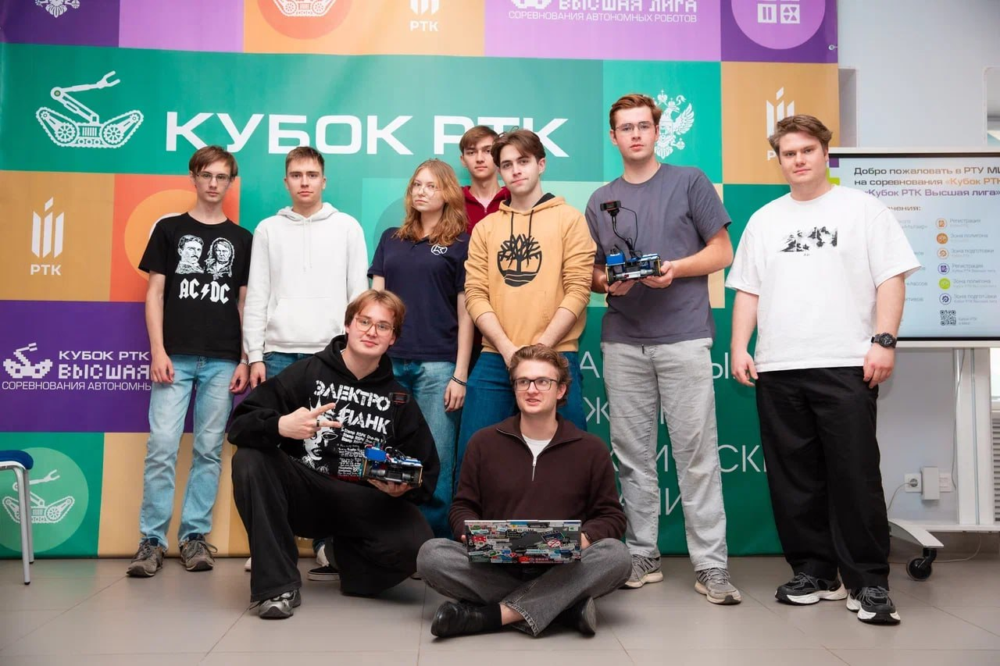
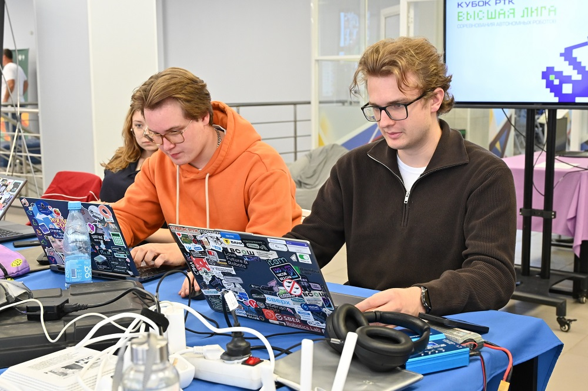
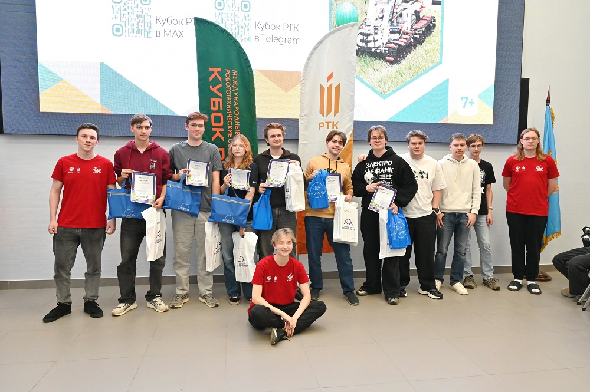
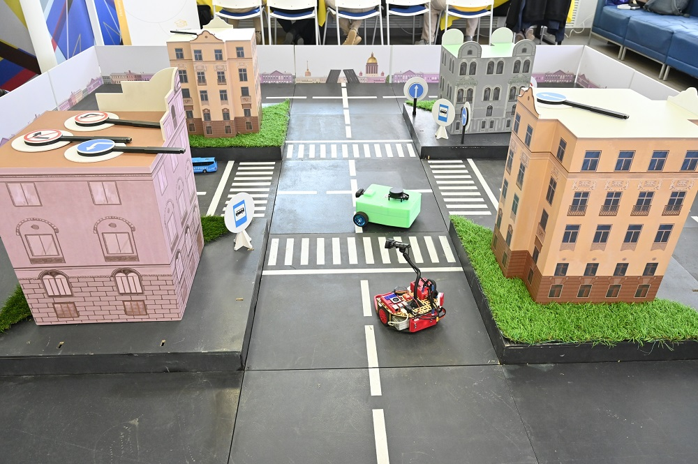
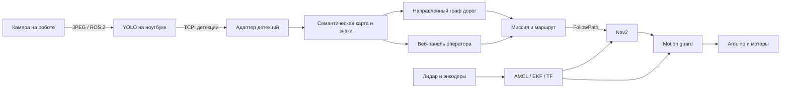

# Frob City · Just_misis_2

**2 место · Кубок РТК: Высшая лига · «Движение по городу»**
РТУ МИРЭА, Детский технопарк «Альтаир», Москва · **12–13 сентября 2026 года**



Решение команды **Just_misis_2** на платформе [Frob](https://github.com/dark516/Frob_robot): робот строит и использует карту города, распознаёт дорожные знаки, выбирает разрешённые манёвры на направленном графе дорог, обслуживает остановки и завершает миссию у парковки. Навигация и логика выполняются в ROS 2, камера передаёт изображения на ноутбук для YOLO, Arduino управляет приводами.

Здесь восстановлена последняя сохранённая рабочая сборка от **13 сентября 2026 года**. Это исходники, конфигурации, модель и тесты разработки; текущее содержимое Raspberry Pi повторно не выгружалось. История происхождения и пределы проверки приведены в [RESTORATION.md](docs/RESTORATION.md).

## Команда

| Участник | Группа | Вклад |
|---|---|---|
| Анастасия Симакова | БПМ-25-6-2 | Компьютерное зрение, обработка изображений и настройка распознавания знаков и меток |
| Александр Кулагин | БПМ-25-6-2 | Программирование, автономное управление, интеграция модулей и логика выполнения маршрута |
| Андрей Рейтлингер | МПМ-26-1 | Электроника, управление приводами через Arduino, настройка обмена с Raspberry Pi и точности манёвров |

Состав, группы и распределение работ приведены по [документу команды](https://docs.google.com/document/d/1Dx7CfzUFGiK_qMGWKIgxIL-VdUjhfhWM1wElrRRp3io/edit?tab=t.ddev6ieapi4e). Второе место и состав также подтверждены [публикацией НИТУ МИСИС](https://misis.ru/news/10689/). Указанный в документе [форк команды](https://github.com/fismay/rtk-city) сохранён как дополнительная ссылка на проект.

## Фотографии этапа

| Работа над решением | Награждение |
|---|---|
|  |  |



Последняя фотография показывает общий полигон и роботов участников, а не отдельный снимок Frob. Источники и подписи: [PHOTOS.md](docs/PHOTOS.md).

## Архитектура



| Пакет | Назначение |
|---|---|
| `frob_city_navigation` | Геометрия поля, семантическая карта, граф, правила знаков, планировщик, миссия, readiness и motion guard |
| `frob_city_interfaces` | ROS-сообщения, сервисы и действия городского стека |
| `frob_city_web` | Карта, калибровка, телеметрия и управление миссией через браузер |
| `traffic_sign_detector` | YOLO, оценка расстояния до знака, видеопоток и TCP-передача детекций |
| `traffic_sign_interfaces` | Сообщения детектора дорожных знаков |
| `frob_navigation` | Nav2, SLAM и сохранённые карты |
| `frob_odometry` | Энкодерная одометрия и EKF |
| `frob_bringup`, `ros2_arduino_bridge` | Аппаратный запуск и связь с приводами |

`GUI_path.py`, `signs_visualizer.py` и JSON-файлы в корне оставлены как прежние инструменты. Финальный городской стек запускается через пакеты `frob_city_*`.

## Установка

Целевое окружение — **Ubuntu 24.04, ROS 2 Jazzy, Python 3.12**. Команды ниже выполняются из `RTK_robot/Frob_gorod`. На роботе предполагается рабочая аппаратная платформа Frob; на ноутбуке необходима связь с роботом по ROS 2 и TCP.

```bash
source /opt/ros/jazzy/setup.bash
sudo apt install python3-colcon-common-extensions python3-rosdep python3-venv
# Если rosdep ещё не настроен: sudo rosdep init
rosdep update
rosdep install --from-paths src --ignore-src -r -y --rosdistro jazzy
python3 -m venv --system-site-packages .venv
source .venv/bin/activate
python -m pip install -r requirements-dev.txt
```

На ноутбуке дополнительно установите среду распознавания:

```bash
python -m pip install -r requirements-vision.txt
```

Сборка финального стека и его зависимостей:

```bash
python /usr/bin/colcon build --base-paths src --symlink-install --packages-up-to frob_city_web
source install/setup.bash
```

Сборка вызывается через `python /usr/bin/colcon`, чтобы исполняемые ROS-узлы использовали Python активной `.venv`, где установлены Shapely и Ultralytics. Веса `src/traffic_sign_detector/models/best.pt` включены. Детектор использует установленный в активном Python-окружении Ultralytics. При отдельной установке через `pip --target` можно передать каталог параметром `ultralytics_vendor_path`.

## Запуск на полигоне

В обоих терминалах настройте одинаковый `ROS_DOMAIN_ID` и выполните `source /opt/ros/jazzy/setup.bash`, активацию `.venv` и `source install/setup.bash`. IP-адреса ниже замените адресами своей сети.

Ноутбук:

```bash
ros2 launch traffic_sign_detector city_competition_offboard.launch.py \
  yolo_device:=cpu listen_port:=18451
```

Робот:

```bash
ros2 launch frob_city_web city_competition_robot.launch.py \
  offboard_host:=10.42.0.1 offboard_port:=18451 include_imu:=false
```

Панель оператора: `http://<IP-робота>:8080`. Калибровки сохраняются в `~/Frob_gorod/calibration`; карта берётся также из установленного пакета `frob_navigation`. Она предназначена для доверенной локальной сети. Запуск поднимает стек в `IDLE` и сам не отправляет `START`. После проверки локализации, камеры, карты и `/city/system_ready` запуском миссии управляет оператор.

```bash
ros2 topic echo /city/system_ready
ros2 topic echo /city/guard_state
ros2 topic hz /traffic_sign/detections_legacy
```

Соревновательные профили: `src/frob_city_navigation/config/andrey_competition_*.yaml`. Карта для запуска: `src/frob_navigation/maps/andrey_map.yaml`; калибровка геометрии: `andrey_manual_field.yaml`. Лабораторная карта сохранена отдельно как `lab_20260913_01.*`.

Профиль motion guard сохранён в состоянии последней полевой проверки (`commissioned: true`, предел 0,12 м/с). Параметры торможения в исходной сборке были консервативными оценками, а не измеренным паспортом робота. Перед новым заездом требуется проверить их на своей платформе; наличие флага не подтверждает готовность другого робота или поля. Аппаратный launch использует Arduino `/dev/ttyACM0` и настройки лидара из базового bringup.

## Проверки

После сборки и загрузки `install/setup.bash`:

```bash
PYTEST_DISABLE_PLUGIN_AUTOLOAD=1 python -m pytest -q
```

Тесты проверяют конфигурации, геометрию, граф, знаки, миссию, защиту движения, веб-компоненты и остановку Arduino при потере команд. Они не заменяют заезд на физическом полигоне. Результаты проверки восстановленной копии: [VALIDATION.md](docs/VALIDATION.md).

## Лицензии

Пакеты сохраняют свои объявления лицензий: `frob_city_*` — Apache-2.0, `traffic_sign_*` — MIT; драйверы и зависимости имеют собственные условия. Для Ultralytics, обученных весов и фотографий см. их источники. Фотографии из публикации МИСИС не объявляются частью лицензии программного кода.
