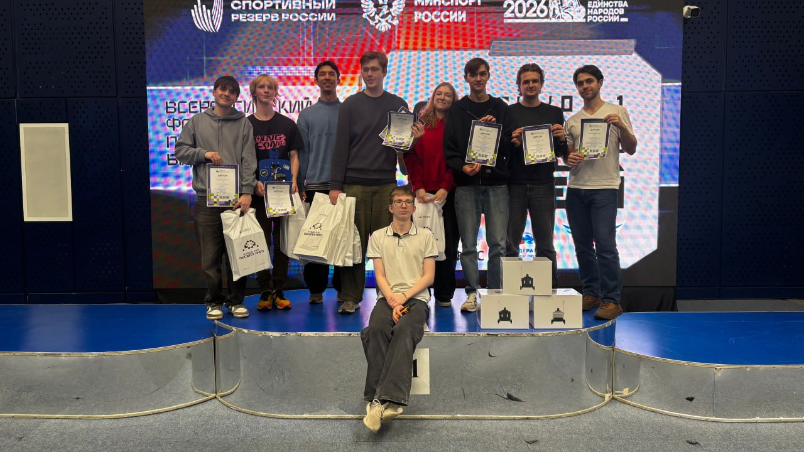
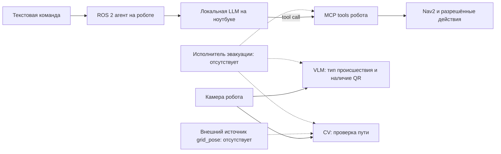
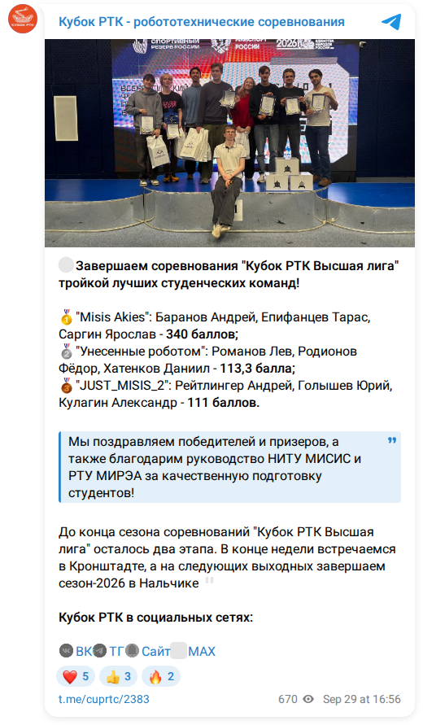
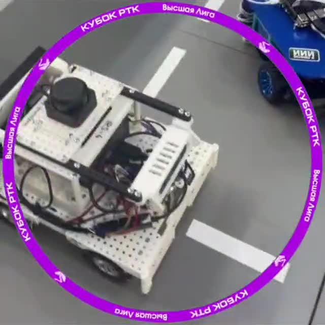
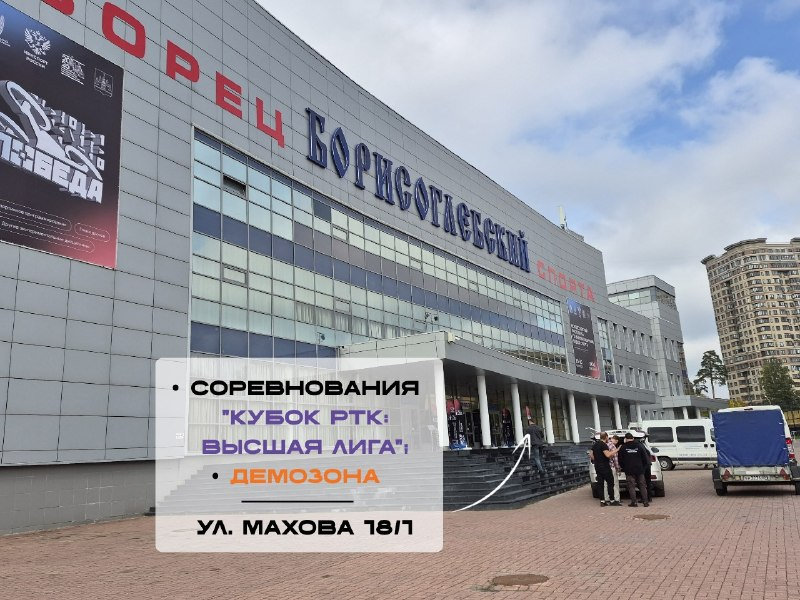

# «Эвакуация» · just_misis_2

**3 место · 111 баллов · Кубок РТК: Высшая лига**

Раменское, дворец спорта «Борисоглебский», ул. Махова, 18/1. Этап проходил **27–29 сентября 2026 года**, зачётные попытки и награждение — **29 сентября**. Результат и состав подтверждены [официальным объявлением организаторов](https://t.me/cuprtc/2383).



Это сохранённые программные компоненты решения задачи «Эвакуация»: ROS 2/Nav2 и аппаратная платформа на роботе, текстовый агент с MCP-инструментами, локальная LLM, VLM-классификация происшествий и быстрая проверка свободного пути. Тяжёлые модели выполняются на ноутбуке. Источник платформы этого решения — [sverk_rover_normal_wheel](https://github.com/dark516/sverk_rover_normal_wheel), отдельно от Frob City.

## Команда

| Участник | Группа | Вклад по материалу команды |
|---|---|---|
| Юрий Голышев | БИВТ-25-6-2 | Автономная навигация, интеграция программных модулей и отладка маршрутов |
| Александр Кулагин | БПМ-25-6-2 | Логика задания, обработка результатов восприятия и согласование компонентов |
| Андрей Рейтлингер | МПМ-26-1 | Аппаратная платформа, электроника, управление приводами и настройка движения |

[Документ команды](https://docs.google.com/document/d/1Dx7CfzUFGiK_qMGWKIgxIL-VdUjhfhWM1wElrRRp3io/edit?tab=t.yhf52ptehpct) содержит распределение работ и группы. Фамилии участников и результат отдельно подтверждает публикация организаторов. Данные этого этапа не смешиваются с составом команды на задаче «Город» в МИРЭА.

## Задача и фактическое состояние кода

По условию робот ищет пострадавшего в разрушенном городе, используя текстовое описание и признаки происшествия. Общий замысел решения: понять запрос → выбрать область → проверить путь → распознать происшествие → найти пострадавшего → вернуться.

**В этой сохранённой копии полный исполнитель такого сценария отсутствует.** Наличие модулей и призового результата команды не доказывает, что из данного снимка можно воспроизвести целую зачётную попытку одной командой.

| Компонент | Что сохранено |
|---|---|
| Робот | 20 ROS 2-пакетов: драйверы, одометрия, локализация, Nav2, камера, веб-интерфейс, агент и MCP |
| Текстовый агент | Команда `/agent/text_command`, вызовы разрешённых MCP tools, `/agent/status` и `/agent/answer` |
| MCP | Навигация к координатам, остановка, относительные движения, датчики и подсветка; фактический список — `tool_schemas.py` |
| Локальная LLM | Gateway для Qwen3.5-9B и двух альтернатив через llama.cpp; OpenAI-compatible API |
| VLM | Qwen2.5-VL-3B: классификация ближайшего происшествия и визуальное наличие QR; `/vlm/analyze_frame` |
| Быстрая CV | ROI, библиотека свободных кадров, `clear` / `blocked` / `unknown`, диагностический UI |
| Недостающие связи | Нет MCP tool `search_static_obstacle`, издателя `/rover/grid_pose`, интегрированного декодирования QR и сценария возврата |

Форматирование ответа `search_static_obstacle` в агенте и его unit-тест используют искусственный результат; это не реализация инструмента. CV без свежего положения в клетке и калибровки возвращает `unknown`. [Карта реализованных и недостающих компонентов](docs/IMPLEMENTATION_STATUS.md).

## Архитектура



Диаграмма показывает сохранённые связи; пунктир — недостающая интеграция. Детали: [ARCHITECTURE.md](docs/ARCHITECTURE.md).

## Модели и восприятие

- LLM: `Qwen3.5-9B-Q4_K_M.gguf`; альтернативы — Qwen3.5-2B и Qwen3.5-35B-A3B.
- VLM: `Qwen2.5-VL-3B-Instruct-Q4_K_M.gguf` с отдельным vision projector.
- CV: OpenCV/NumPy, сравнение ближайшего дорожного ROI с библиотекой свободных кадров.

VLM возвращает `event_type`: `traffic_accident`, `fuel_truck`, `fallen_tree`, `building_debris`, `none` или `unknown`. Поле `qr` сообщает только **наличие** кода (`present`, `absent`, `unknown`), а не его содержимое. Собственная `confidence` VLM не является откалиброванной вероятностью и не служит разрешением движения.

Веса GGUF, калибровки, TLS-ключи и результаты сборки в Git не включены. [Список моделей и запуск](docs/REPRODUCIBILITY.md).

## Сборка и запуск

Целевое окружение: Ubuntu 24.04, ROS 2 Jazzy, Python 3.12. `robot_ws` и `ai_ws` содержат разные варианты пакета **с одинаковым именем `rover_vision`**. Собирайте их раздельно и используйте отдельные терминалы; не накладывайте оба workspace друг на друга.

```bash
# В отдельном терминале робота
cd evakuacia/robot_ws
source /opt/ros/jazzy/setup.bash
rosdep install --from-paths src --ignore-src -r -y --rosdistro jazzy \
  --skip-keys "ament_python ament_pytest python3-spidev"
python3 /usr/bin/colcon build --base-paths src --symlink-install
source install/local_setup.bash
```

```bash
# В отдельном терминале ноутбука
cd evakuacia/ai_ws
source /opt/ros/jazzy/setup.bash
rosdep install --from-paths src --ignore-src -r -y --rosdistro jazzy \
  --skip-keys "ament_python ament_pytest python3-spidev"
python3 /usr/bin/colcon build --base-paths src --symlink-install
source install/local_setup.bash
ros2 launch rover_vision local_llm_gateway.launch.py autostart:=false
```

Последняя команда открывает диагностический gateway без загрузки модели и без управления роботом. Физический bringup, IP-адреса, параметры llama.cpp и раздельный запуск CV/VLM описаны в [REPRODUCIBILITY.md](docs/REPRODUCIBILITY.md). Старые systemd-файлы сохранены как исторические шаблоны и не устанавливаются автоматически.

## Подтверждение результата

[](https://t.me/cuprtc/2383)

Это объявление организаторов, опубликованное 29 сентября, а не подписанный протокол. Отдельного публичного итогового протокола этого зачёта при проверке не найдено.

## Фотографии этапа

| Полигон, 29 сентября | Площадка Высшей лиги |
|---|---|
|  |  |

Полигон показан кадром 00:01 из [видео организаторов](https://t.me/cuprtc/2382). Принадлежность отдельных роботов на кадре не установлена. Фото здания опубликовано в [схеме площадок](https://t.me/cuprtc/2369). Таблицы награждения другого зачёта исключены. [Все источники изображений](assets/photos/README.md).

## Проверки и происхождение

[VALIDATION.md](docs/VALIDATION.md) фиксирует проверки именно этой копии, [SOURCE_SNAPSHOT.md](docs/SOURCE_SNAPSHOT.md) — происхождение исходников, [SOURCES.md](docs/SOURCES.md) — источники фактов. Аппаратный заезд в рамках восстановления не выполнялся; LLM/VLM-веса в повторной проверке не загружались.

## Лицензии

Пакеты и драйверы сохраняют собственные лицензии. Условия моделей, runtime llama.cpp и фотографии рассматриваются отдельно; фотографии не объявляются частью лицензии программного кода.
