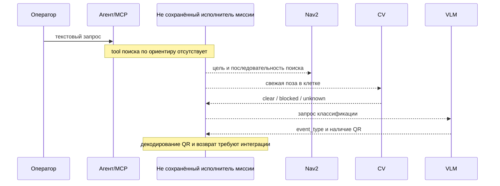

# Архитектура сохранённых компонентов

## Робот: ROS 2 и инструменты

`/agent/text_command` → `agent_text_node` → OpenAI-compatible API локальной LLM → MCP JSON-RPC → разрешённый tool из `tool_schemas.py`. Результаты публикуются в `/agent/status` и `/agent/answer`. MCP работает на loopback `:8766/mcp` при запуске через профиль bringup.

LLM не получает shell или произвольный ROS CLI. Список tools включает прямую навигацию к координатам через `/navigate_to_pose`, отмену, относительное движение, остановку и получение состояния. В нём нет `search_static_obstacle`; форматтер результата с этим именем не доказывает наличие исполнителя.

Драйверы, одометрия, TF/EKF, AMCL и Nav2 находятся в `robot_ws`. Сохранённые карты и калибровки не прилагаются: bringup с Nav2 требует действующий YAML карты.

## Ноутбук: LLM, VLM и CV

| Компонент | Интерфейс |
|---|---|
| LLM gateway | HTTP `:8083/v1`, HTTPS UI `:8082`, llama.cpp backend `127.0.0.1:8092` |
| VLM | llama.cpp backend `127.0.0.1:8091`, UI `:8081`, `/vlm/analyze_frame` |
| Камера робота | HTTP `http://ROBOT_IP:8091/stream?mode=live` и `/frame?mode=live` |
| CV | `/road/state`, `/path_clearance`, `/path_clearance/debug/compressed`, UI `:8080` |

Камера и VLM backend используют одинаковый порт 8091 на **разных машинах**. Не заменяйте IP робота на loopback ноутбука в URL камеры.

CV получает входящий JSON `/rover/grid_pose`, выбирает профиль, сравнивает перспективный ROI с библиотекой свободных кадров и применяет временное сглаживание. Для отсутствующей/устаревшей позы или отсутствующей калибровки возвращает `unknown`. Текущая реализация имеет два профиля, `normal` и `bridge`, и список поз мостовых подходов; отдельные четыре независимые библиотеки по направлениям в коде не реализованы. Издатель позиции в данной копии отсутствует.

VLM выполняет структурированную классификацию ближайшего происшествия и отдельный запрос наличия QR. Она не декодирует содержимое QR. JSON Schema ограничивает форму ответа, но не делает классификацию безошибочной.

## План полной миссии

Пунктирные связи описывают замысел, который нельзя считать реализованным в этом снимке. [IMPLEMENTATION_STATUS.md](IMPLEMENTATION_STATUS.md) перечисляет подтверждения и недостающие части.
